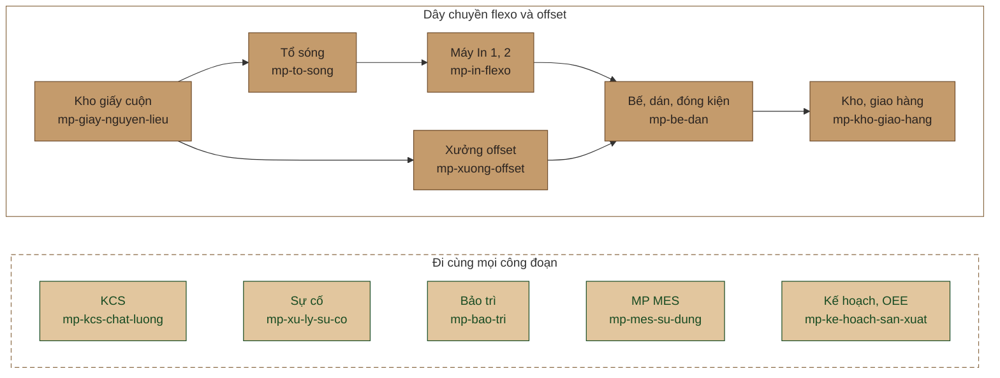

<p align="center">
  
</p>

<p align="center">
  
  
  
  
</p>

Bộ skill cho Claude và kho kiến thức dùng hằng ngày ở **Công ty TNHH Bao Bì Minh Phúc**: chạy máy, xử lý lỗi, kiểm chất lượng, bảo trì, đọc số liệu MP MES, trả lời khách và đào tạo người mới.

Mọi thứ bám vào xưởng thật: máy Minh Phúc có, 127 mã lỗi xưởng đang dùng, luật sản xuất đã chốt. Kiến thức ngành (FEFCO, ISO, TAPPI, NZQA, Sun Chemical) chỉ bổ sung và luôn ghi nguồn.

## Cài vào Claude Code

```text
/plugin marketplace add SangTDH-HT/MinhPhuc_Toolkit
/plugin install minhphuc-toolkit@minhphuc-toolkit
```

Repo riêng tư nên máy cài phải đăng nhập GitHub có quyền đọc repo (`gh auth login`). Dùng bản trên máy thì thay dòng đầu bằng `/plugin marketplace add C:\MinhPhuc_Toolkit`. Cũng có thể mở thẳng thư mục repo trong Claude Code. Câu hỏi mẫu cho từng vai trò nằm ở [docs/HUONG-DAN-SU-DUNG.md](docs/HUONG-DAN-SU-DUNG.md).

## Bản đồ skill theo dây chuyền

Skill xếp theo đúng đường đi của một đơn hàng qua xưởng. Câu hỏi nào cũng vào `minhphuc` trước, skill này chuyển tiếp tới đúng chỗ. Hàng dưới, viền nét đứt như đường cấn trên bản vẽ khuôn, là những việc đi cùng mọi công đoạn.



## Tất cả skill

### Công ty và sản phẩm

| Skill | Dùng khi |
|---|---|
| [minhphuc](skills/minhphuc/SKILL.md) | Mọi câu hỏi về Minh Phúc. Định tuyến, thứ bậc nguồn tin, cách trả lời |
| [mp-cong-ty](skills/mp-cong-ty/SKILL.md) | Cần biết công ty có máy gì, làm cho khách nào, đang hướng tới đâu |
| [mp-san-pham-ket-cau](skills/mp-san-pham-ket-cau/SKILL.md) | Đọc quy cách, chọn sóng và số lớp, mã FEFCO, tính phôi |
| [mp-giay-nguyen-lieu](skills/mp-giay-nguyen-lieu/SKILL.md) | Nhận giấy cuộn, đọc COA, lỗi có gốc nguyên liệu |
| [mp-ho-tro-kinh-doanh](skills/mp-ho-tro-kinh-doanh/SKILL.md) | Tư vấn khách, báo giá phần kỹ thuật, làm mẫu, chuyển đơn mới |

### Tổ máy

| Skill | Dùng khi |
|---|---|
| [mp-to-song](skills/mp-to-song/SKILL.md) | Tấm cong, phồng, bong lớp; keo, hơi, nhiệt; ghép đơn, khổ giấy |
| [mp-in-flexo](skills/mp-in-flexo/SKILL.md) | In nhoè, mờ, sai màu, lệch chồng màu; mực, anilox, bản |
| [mp-xuong-offset](skills/mp-xuong-offset/SKILL.md) | In offset, bồi sóng, cán màng, máy xén |
| [mp-be-dan](skills/mp-be-dan/SKILL.md) | Khuôn bế, tách rác, khe dán, đuôi cá, phiếu pallet |
| [mp-bao-tri](skills/mp-bao-tri/SKILL.md) | Bảo trì phòng ngừa, máy hỏng, bôi trơn, sổ lý lịch máy |

### Chất lượng và hệ thống sản xuất

| Skill | Dùng khi |
|---|---|
| [mp-kcs-chat-luong](skills/mp-kcs-chat-luong/SKILL.md) | Phép thử BCT, ECT, Cobb; lấy mẫu AQL; dung sai; kiểm đầu đơn |
| [mp-xu-ly-su-co](skills/mp-xu-ly-su-co/SKILL.md) | Có lỗi hoặc khiếu nại: gọi đúng mã, tìm nguyên nhân gốc, 8D |
| [mp-ke-hoach-san-xuat](skills/mp-ke-hoach-san-xuat/SKILL.md) | Đọc số giờ chạy, ngừng, tốc độ, OEE, đơn vị đếm từng máy |
| [mp-mes-su-dung](skills/mp-mes-su-dung/SKILL.md) | Thao tác trên MP MES, cảnh báo, máy Giám sát, Trợ lý |
| [mp-an-toan-lao-dong](skills/mp-an-toan-lao-dong/SKILL.md) | Khoá năng lượng, gỡ kẹt, hoá chất, phòng cháy |
| [mp-fsc-iso-attp](skills/mp-fsc-iso-attp/SKILL.md) | Đơn FSC, đánh giá ISO 9001, hộp tiếp xúc thực phẩm |
| [mp-kho-giao-hang](skills/mp-kho-giao-hang/SKILL.md) | Xếp pallet, tính container, bảo quản, giao hàng |

### Công cụ và phát triển

| Skill | Dùng khi |
|---|---|
| [mp-tinh-toan](skills/mp-tinh-toan/SKILL.md) | Cần một con số tính đúng: BCT, McKee, định lượng, CBM, AQL, OEE |
| [mp-bieu-mau](skills/mp-bieu-mau/SKILL.md) | Cần phiếu để in: kiểm đầu đơn, NCR, 8D, LOTO, giao ca |
| [mp-dao-tao](skills/mp-dao-tao/SKILL.md) | Nhận người mới, lập ma trận kỹ năng, soạn câu hỏi kiểm tra |
| [mp-cai-tien](skills/mp-cai-tien/SKILL.md) | Chọn việc cải tiến, làm A3, đổi đơn nhanh |
| [mp-thu-vien](skills/mp-thu-vien/SKILL.md) | Cần nguyên văn tiêu chuẩn, thêm tài liệu mới vào kho |

## Hỏi thử

> Tấm 5 lớp BC đang cong lên ở đầu ra, cuộn mặt vừa thay. Xử lý sao?

> Máy In 2 in nền đỏ bị sọc ngang và nhạt dần, mực đỏ đo 28 giây cốc Ford.

> Khách báo thùng bẹp ở kho lạnh sau 3 tuần. Làm giúp báo cáo 8D.

> Lô 12.000 thùng thì lấy bao nhiêu mẫu, cho phép mấy thùng lỗi ở mức AQL 1,5?

## Nguồn tin và độ tin

Mỗi dữ kiện trong skill gắn nhãn nguồn. Khi hai nguồn nói khác nhau, nhãn cao hơn thắng và chỗ vênh được ghi vào [docs/CAN-XAC-NHAN.md](docs/CAN-XAC-NHAN.md).

| Nhãn | Nghĩa |
|---|---|
| **[MP]** | Đã xác nhận tại xưởng hoặc là luật MP MES đã chốt |
| **[MP-Web]**, **[MP-HSNL]** | Công ty công bố trên web, hồ sơ năng lực, chứng nhận |
| **[Chuẩn]** | Tiêu chuẩn và tài liệu nghề có tên |
| **[KN ngành]** | Kinh nghiệm chung của nghề, chưa kiểm tại Minh Phúc |

## Trong repo có gì

```text
skills/           22 skill, mỗi skill gồm SKILL.md và thư mục references
data/             127 mã lỗi, máy móc, sóng, phép thử, thuật ngữ Việt – Anh – Trung, 45 mẫu sản phẩm
templates/        18 biểu mẫu Markdown in được
tools/tinh-toan/  máy tính kỹ thuật (python -m mptinh), có test
scripts/          kiểm tra repo, xuất PDF, tải lại thư viện tài liệu, vẽ banner
sources/          danh mục và nguồn tải của thư viện tài liệu gốc
docs/             kiến trúc, hướng dẫn dùng, việc cần xác nhận, lộ trình
```

Kiểm tra trước khi commit:

```text
python scripts/kiem_tra_repo.py
python -m unittest discover -s tools/tinh-toan/tests
```

## Phạm vi

Repo không chứa lập trình PLC hay HMI, mã nguồn và cấu hình MP MES, TIA Portal, địa chỉ mạng, tài khoản, mật khẩu hay giá. Tài liệu PDF của bên thứ ba không đưa lên git; tải lại bằng `scripts/tai_thu_vien.py`. Thông số gắn **[KN ngành]** là điểm xuất phát, phải kiểm tại xưởng trước khi đưa vào quy trình.

Lộ trình làm repo mạnh hơn: [docs/LO-TRINH.md](docs/LO-TRINH.md). Góp nội dung: [CONTRIBUTING.md](CONTRIBUTING.md).

<sub>Biên soạn: Nguyễn Hữu Sáng, Công ty TNHH Bao Bì Minh Phúc, 2026. Tài liệu nội bộ.</sub>
